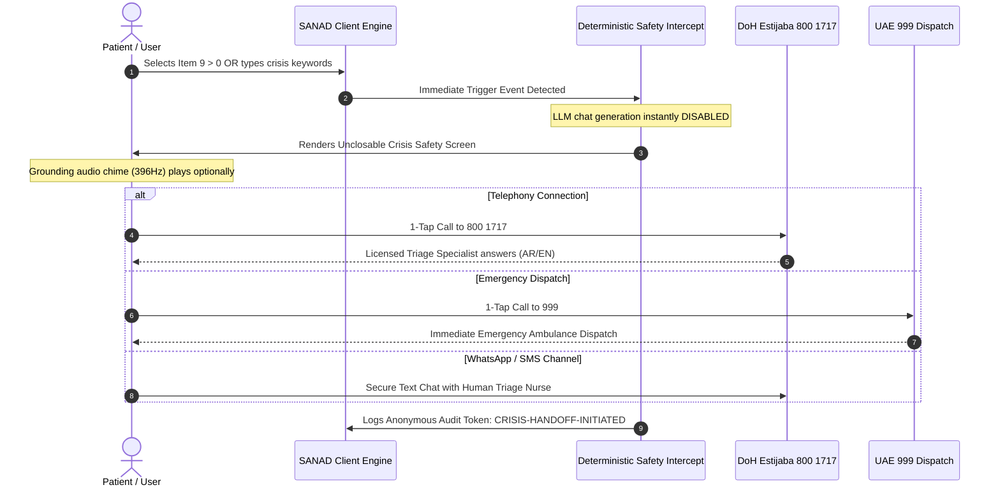

# SANAD Abu Dhabi (سَنَد)
## Clinical Safety Case Report & Hazard Log (DCB0129 / DoH Abu Dhabi Standards)

**Document Reference:** SANAD-CSCR-2027-V1  
**Clinical Safety Officer (CSO):** Dr. M. Al-Mansoori, MD, FRCPsych (DoH Consultant Psychiatrist)  
**Lead Digital Health Architect:** SANAD Multidisciplinary Engineering Council  
**Regulatory Alignment:** Department of Health – Abu Dhabi (DoH) Policy on Tele-Mental Health & Health Data Protection; NHS DCB0129 / DCB0160 Clinical Risk Management Equivalent.

---

## 1. Executive Clinical Safety Summary

SANAD Abu Dhabi is engineered as an **assistive, non-diagnostic digital mental health navigation ecosystem**. It is designed specifically to avert the clinical failure modes of commercial wellness apps and unregulated AI chatbots.

### Core Safety Foundations:
1. **Zero Diagnostic Autonomy:** Under no circumstances does the software generate a DSM-5 or ICD-11 psychiatric diagnosis, prescribe pharmacotherapy, or simulate therapeutic counseling during acute distress.
2. **Deterministic Triage Routing:** Care recommendations across the 5 Stepped-Care Tiers are driven by deterministic, clinically validated psychometric thresholds (PHQ-9, GAD-7, WHO-5), rather than probabilistic or generative black-box algorithms.
3. **Continuous Safety-Critical Intercept (Item 9 Guardrail):** Any positive response ($>0$) on PHQ-9 Question 9 immediately halts self-care guidance and transitions the interface into an unclosable human crisis escalation pathway.
4. **Human-in-the-Loop Hand-Off:** High-risk presentations are handed off directly to licensed triage personnel at **Estijaba 800 1717** (Abu Dhabi Department of Health) or **999** emergency dispatch.

---

## 2. Clinical Hazard Identification & Risk Log (Hazard Matrix)

The clinical council conducted a Failure Mode and Effects Analysis (FMEA) across all user touchpoints. Each hazard is assessed for Initial Risk (Severity $\times$ Likelihood), mitigation controls applied, and Residual Risk.

| Hazard ID | Clinical Hazard Description | Failure Mode / Root Cause | Initial Risk | Clinical & Engineering Mitigations | Residual Risk |
|:---|:---|:---|:---:|:---|:---:|
| **HAZ-01** | **Suicide or self-harm risk undetected or masked by self-help tools** | A high-risk user completes an assessment but is directed to self-guided breathing, delaying acute emergency intervention. | **CRITICAL** (Catastrophic $\times$ Medium) | **Deterministic Item 9 Intercept:** Any score $>0$ on PHQ-9 Item 9 triggers an immediate full-screen crisis lock-out. AI chat disables all text generation and displays direct links to Estijaba 800 1717 and 999. Generative responses are blocked. | **VERY LOW** (Acceptable with Audit) |
| **HAZ-02** | **Inappropriate automated diagnostic labelling** | User misinterprets informational symptom score as a formal psychiatric diagnosis, causing severe psychological distress or social stigma. | **HIGH** (Moderate $\times$ High) | **Non-Diagnostic UI Language:** Scores are framed as *"Current Balance Indicators"* (*"مؤشرات التوازن الحالية"*). Clear warnings display: *"This assessment indicates current symptom intensity and does not constitute a medical diagnosis."* | **LOW** (Acceptable) |
| **HAZ-03** | **Hallucinatory clinical advice from Conversational AI** | Assistive LLM suggests unverified supplements, medications, or unsafe behavioral advice for trauma. | **CRITICAL** (Major $\times$ High) | **Constrained Semantic Engine:** AI is restricted to directory navigation, clinic scheduling, and DoH psychoeducation. System prompts enforce strict negative constraints forbidding clinical prescribing or diagnostic inferences. | **VERY LOW** (Acceptable) |
| **HAZ-04** | **Data breach disclosing mental health status to employers or insurers** | User's assessment score or session notes leak to corporate HR or insurance underwriting, triggering employment discrimination or loss of coverage. | **CRITICAL** (Catastrophic $\times$ Medium) | **Zero-Profile Guest Mode & Zero-Knowledge Vault:** Data remains encrypted on the client device via WebCrypto. Individual databases are physically and logically segregated from B2B dashboards. Compliant with UAE Federal Law No. 2 of 2019. | **VERY LOW** (Acceptable) |
| **HAZ-05** | **Delayed referral completion / Drop-off after positive screening** | User screens positive for moderate-to-severe depression but encounters complex booking friction and abandons care. | **HIGH** (Major $\times$ Medium) | **Closed-Loop Stepped Navigation:** Direct booking integration with DoH-licensed clinicians; generation of a 1-page "Doctor Discussion Brief"; automated 7-day and 14-day check-in reminders. | **LOW** (Acceptable) |
| **HAZ-06** | **Misattribution of physical illness symptoms to mental health** | Somatic symptoms (e.g., fatigue from diabetic ketoacidosis or thyroid dysfunction) mischaracterized purely as depression. | **HIGH** (Major $\times$ Medium) | **Integrated Care Protocol (Level 3 GP First):** Level 3 routes individuals with somatic distress to primary care physicians for routine blood work (HbA1c, TSH, CBC) before psychiatric referral. | **LOW** (Acceptable) |

---

## 3. Human Crisis Hand-Off Protocol (Estijaba 800 1717)

---

## 4. Clinical Safety Officer (CSO) Sign-off Requirements

Before production deployment across Abu Dhabi healthcare networks:
1. **Clinical Validation:** Psychometric translations in Emirati Arabic and Modern Standard Arabic must be reviewed and certified by a panel of at least three DoH-licensed bilingual clinical psychologists.
2. **Penetration Testing:** Complete security verification under the DoH Healthcare Information and Cyber Security (HICS) standard, confirming zero employer data leakage.
3. **End-to-End Emergency Telephony Drills:** Simulated crisis calls to the Estijaba 800 1717 operations room to ensure zero latency, zero call drops, and accurate human escalation.
4. **Post-Market Clinical Surveillance:** Quarterly reviews of the Adverse Event Register, false-negative crisis intercepts, and screening-to-consultation conversion metrics.

---
*Signed by the Clinical Safety Working Group – SANAD Abu Dhabi Ecosystem.*

